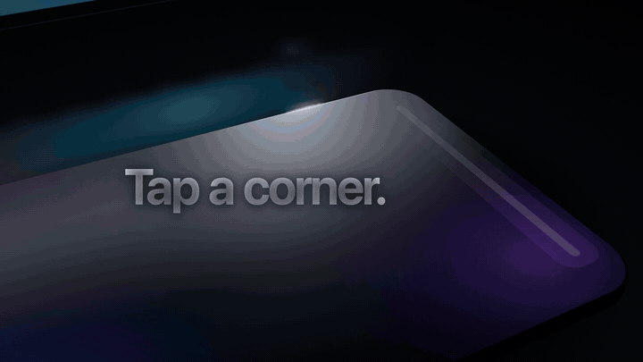
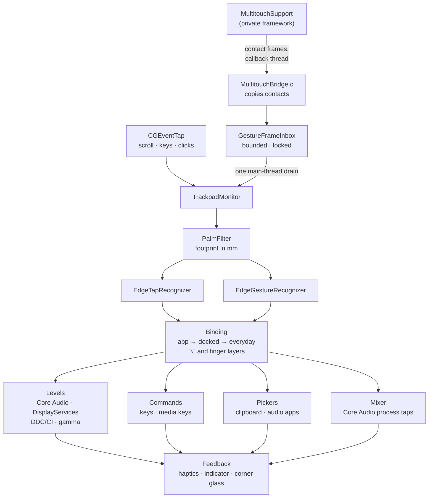

<div align="center">

# Kinara

**The edges of your trackpad, as controls.**

A native macOS menu bar app that turns the edges and corners of the trackpad into
volume, brightness, a fader for every app, a one-finger clipboard and 53 actions,
behind palm rejection that measures every contact.


[Releases](https://github.com/0x1p0/kinara/releases) ·
[User guide](docs/USER-GUIDE.md) ·
[Verifying](docs/VERIFYING.md) ·
[Releasing](docs/RELEASING.md)



</div>

---

## At a glance

| | |
| --- | --- |
| **Platform** | macOS 13 Ventura or later; one universal binary for Apple silicon and Intel |
| **Stack** | Swift (language mode 5) with SwiftUI and AppKit, plus one C bridge to MultitouchSupport |
| **Dependencies** | One: [Sparkle](https://sparkle-project.org) 2.10 for updates, pinned by checksum |
| **Input** | Raw contacts from MultitouchSupport, and a Quartz event tap for scroll, key and click ownership |
| **At rest** | About 0.015% of one CPU core and 12 MB of memory, paused and icon-only ([method](docs/VERIFYING.md#idle-footprint)) |
| **Network** | Update checks against GitHub Releases (can be turned off) and Sparkle. No analytics, no account |
| **Tests** | 19 suites, about 3,400 assertions. None touch real hardware, permissions or saved preferences |
| **Distribution** | Hardened Runtime, a persistent signing identity, Ed25519-signed updates. Not yet notarized |
| **Licensing** | Free and open source under the [MIT License](LICENSE). No trial, no account, no ads |

## Contents

- [Architecture](#architecture)
- [Engineering invariants](#engineering-invariants)
- [Subsystems](#subsystems)
- [Performance](#performance)
- [Testing](#testing)
- [Security and release engineering](#security-and-release-engineering)
- [Build and run](#build-and-run)
- [Install](#install)
- [Requirements and honest limits](#requirements-and-honest-limits)
- [Repository layout](#repository-layout)
- [Contributing](#contributing)
- [License](#license)

## Architecture



**The life of a gesture**

1. **Contacts.** MultitouchSupport delivers frames on its own thread. `MultitouchBridge.c` copies each
   contact: identity, normalized position, and the sensor's ellipse in millimetres.
2. **Inbox.** `GestureFrameInbox` holds up to 64 frames under a lock and schedules exactly one
   main-thread drain per batch. On overflow it drops the backlog, cancels the gesture and waits
   for the fingers to lift. A backlog is never replayed onto hardware.
3. **Staleness.** A frame older than 120 ms by the time it is handled cancels the gesture instead
   of applying it.
4. **Palms.** `PalmFilter` removes anything that isn't fingertip-shaped before any recognizer sees
   it (see [palm rejection](#gestures-and-palm-rejection)).
5. **Recognition.** `EdgeTapRecognizer` handles double-tap and tap-and-hold on edges and corners;
   `EdgeGestureRecognizer` accepts a slide only after touchdown, sample count, axis travel,
   straightness, per-finger movement and recent typing all check out.
6. **Binding.** Resolved once per touch sequence, in order: app profile, docked profile, everyday
   setup; then the ⌥ layer, the other-finger-count layer, or an armed tap.
7. **Value.** `RelativeGestureValue` shapes travel (precision when sliding inward, a speed curve,
   notch capture). Controllers coalesce writes off the main thread, and feedback follows the
   device's readback, never the request.
8. **Feedback.** Haptics with a grammar (a double tick for a tap action, a single one for undo), the
   level indicator, the corner glass, and a light along the screen edge being used.

## Engineering invariants

Each of these is enforced in code, and most are pinned by a regression test.

| Invariant | How |
| --- | --- |
| **Input never waits on Kinara.** | `MainThreadWatchdog` checks the main thread four times a second from its own thread. After one second without an answer it switches the event taps off from there. A tap macOS disables for timeout is recovered, and the gesture in flight is cancelled. |
| **No replayed backlog.** | The bounded inbox and the 120 ms staleness rule (above). |
| **Losing Accessibility is noticed within about a second.** | Kinara listens for macOS's Accessibility-change notification and confirms with a fresh probe tap, because `AXIsProcessTrusted()` kept answering yes for minutes on macOS 27. Then every tap comes out of the input path and the pointer is restored. |
| **A scroll that started stays a scroll.** | In two-finger mode, ownership is decided at the real scroll start from macOS's scroll phases, and an edge control keeps its whole inertia tail. |
| **Fail closed.** | Every control checks capability first: a writable volume, a readable hardware mute, DDC support, CoreBrightness method signatures. Unsupported hardware is reported, never simulated. A device change cancels pending adjustments instead of retargeting them. |
| **Nothing on a timer that doesn't need one.** | The input tap never receives pointer movement; a second tap exists only while a one-finger slide holds the pointer. The clipboard is read after a copy, never polled. The mixer listens to Core Audio process notifications. Update checks use one non-repeating timer. |
| **Private by construction.** | Touch data is processed and discarded. Clipboard history lives in memory only, and password-manager items are skipped. App audio routed through a process tap is never recorded, saved or sent. There is no analytics. |
| **Permission survives updates.** | Every release is signed by one persistent identity whose designated requirement pins the bundle ID and certificate, so macOS keeps the Accessibility grant across updates. |

## Subsystems

### Gestures and palm rejection

The trackpad reports every contact as an ellipse. Measured on a MacBook Air:

- **Fingertips** stayed at most 8.5 mm wide, though a fast swipe can smear one to 14 mm long.
- **Palms** were 15–17 mm wide and 25–28 mm long. Even a palm grazing a corner was 10 mm wide
  from its first report.

So a contact 10 mm or wider is a palm, and so is one 17 mm or longer while nearly still (the
side of a hand, or a flat thumb). A palm stays a palm until it lifts; a touch that grows into a
palm stops whatever it began and is never read as a tap. Fingertips beside a resting palm still
work. On top of that, the recognizer checks stable contact identities, touchdown inside one
enabled zone, enough samples and travel on the intended axis, direction and straightness,
per-finger movement, recent typing, extra or replaced fingers, and implausible jumps. A rejected
touch stays rejected until every finger lifts.

**Settings → Edges & corners → Advanced → Test safely** shows the rule behind each decision,
live, without changing anything on the Mac.

### Audio

- **Output volume and input gain** through Core Audio, with comfort limits remembered per device.
- **Hardware mute** only where the driver exposes a readable, writable mute control. Gain zero is
  never called "muted".
- **A fader for every app** (macOS 14.2+): mute, solo, per-app output, boost to 150% through a
  soft limiter, and call ducking while an app uses the microphone. Kinara reroutes an app through a
  Core Audio process tap only while it needs to, and one tap engine serves the mixer and the App
  volume action, so no app is ever tapped twice.

### Displays

- **Brightness follows the pointer:** Apple displays through DisplayServices, other monitors over
  DDC/CI on Apple silicon, otherwise the built-in panel.
- **Extra dim** goes below the backlight minimum by scaling the display's gamma, which macOS
  restores when Kinara quits.
- **Night Shift and True Tone** use private CoreBrightness clients, checked by method signature
  before every use.

### Clipboard history

Event-driven: Kinara reads the clipboard right after a copy it can see (⌘C, ⌘X, its own Copy and
Cut, an app switch, or opening the picker). It keeps 10 to 100 copies, text and optionally
pictures (up to 256 MB, oldest first), in memory only. Items that password managers mark as
concealed or transient are skipped. In the picker, type to search; ⌘1 to ⌘9 paste the first nine.

### Now Playing

Music and Spotify are read through Apple Events. macOS asks once per player, and Kinara never
launches one. Other players appear where macOS still exposes them.

### Interface

- **Glass:** on macOS 26 and later, the panel uses the system popover's Liquid Glass, and the
  indicator embeds its readout in `NSGlassEffectView`. Earlier versions use native materials.
  Reduce Transparency and Reduce Motion are honored.
- **Settings:** six pages (Home, Edges & corners, Feel, Sound & display, Apps, General), each
  simple first, with an Advanced sheet for the rest.
- **Taps answer in place:** a corner tap answers with one piece of glass in that corner, a bead
  that stretches into a pill naming the action.

The [user guide](docs/USER-GUIDE.md) covers every control.

## Performance

- **Idle:** a paused, icon-only profile measured about 0.015% of one CPU core and 12.3 MB of
  physical memory on Apple silicon. That's one short sample, not a guarantee;
  `scripts/profile-idle.sh` reproduces it ([method](docs/VERIFYING.md#idle-footprint)).
- **Indicator:** at most 60 visual updates per second. Its window is created on first use, and
  no timer runs after it hides.
- **Haptics:** at most one request per 50 ms, with no pulse queue. Detents sit at fixed levels and
  follow the requested level on its own frame, never device readback; hysteresis keeps a resting
  finger from crossing one repeatedly.
- **Views:** the menu panel's SwiftUI hierarchy is built when it opens and released when it
  closes, and the same goes for Settings.

## Testing

Every suite runs with fake hardware, isolated preferences and test backends. None changes a
system level, requests a permission, registers a shortcut or launches the production app.
[Checks](.github/workflows/checks.yml) runs them all on every push and pull request.

| Area | Command | Assertions | What it pins down |
| --- | --- | ---: | --- |
| Gesture recognizer | `scripts/test-gestures.sh` | 253 | Intent, rejection, scroll ownership, staleness |
| Palm rejection | `scripts/test-palm-rejection.sh` | 60 | Footprint and intent rules on synthetic traces |
| Control model | `scripts/test-controls.sh` | 528 | Every action's metadata and icon, steppers, panel state from readback |
| Settings | `scripts/test-settings.sh` | 343 | Migration, normalization, profiles, export and import (91 cases) |
| Haptics | `scripts/test-haptics.sh` | 132 | Fixed detents on the shown number, hysteresis, rate limits, fake clock and performer |
| Edge light | `scripts/test-edge-light.sh` | 90 | Overlay window joins full-screen Spaces; every colour reads at 3:1 on any background; the ambient lap |
| Audio | `scripts/test-audio.sh` | 163 | Volume, mute and gain rules on a fake backend |
| Brightness | `scripts/test-brightness.sh` | 61 | Fresh baselines, writes off the main thread, latest value wins |
| DDC/CI | `scripts/test-ddc.sh` | 117 | Monitor identity and command framing, in memory |
| App volume | `scripts/test-app-volume.sh` | 91 | Gain, boost and limiter on hand-built buffers |
| Mixer | `scripts/test-mixer.sh` | 55 | Solo, ducking, routing rules, detection |
| Now Playing | `scripts/test-now-playing.sh` | 1,362 | Parsing and seeking logic, no Apple Events |
| Presentation | `scripts/test-presentation.sh` | 79 | First click, focus, Dock presence, popover lifecycle |
| Updates | `scripts/test-updates.sh` | 82 | Feed parsing and scheduling over mock HTTP |
| Update signing | `scripts/test-update-signing.sh` |  | Altered feeds, archives and keys fail, with disposable keys |
| Release tooling | `Tests/*.py`, `Tests/*.rb` | 103+ | Runtime entitlements, signing identity, archives, packaging, release policy |

[Verifying](docs/VERIFYING.md) covers the offscreen UI renderer, the idle profiler and the
checklist for physical hardware, which no automated trace can replace.

## Security and release engineering

- **Hardened Runtime with exactly three entitlements:** Apple Events (Now Playing), audio input
  (App volume's process tap), and a library-validation exception that self-signing needs for
  Sparkle. The runtime verifier rejects any other entitlement.
- **Signing:** one persistent identity. Its designated requirement pins the bundle ID and the
  exact certificate, so updates keep their permissions and nobody can imitate them by bundle ID
  alone. A Developer ID and notarization path is ready in `scripts/notarize.sh`.
- **Updates:** Sparkle with an Ed25519-signed feed and archive. A bad signature never falls back
  to an unsigned update, and automatic downloads are off.
- **Releases:** `bash scripts/release.sh <version>` raises the version, commits, tags and
  pushes; the tag starts four jobs on fresh runners with two manual approvals. Each private key
  exists only in an approval-protected environment and only in its own signing step. Releases
  are immutable once published. See [Releasing](docs/RELEASING.md).
- **Supply chain:** actions pinned by commit SHA, Sparkle pinned by checksum, DMG tools pinned by
  hash, and Dependabot on top.

## Build and run

With Xcode 26 or later selected:

```bash
bash scripts/build.sh
```

This makes an optimized build for the current architecture with a macOS 13 deployment target,
warnings as errors, ad-hoc signed into `build/Kinara.app`. It never replaces an installed copy.

- **Without the Xcode build service:** `scripts/build.sh --direct`.
- **Another architecture:** set `KINARA_ARCH` to `arm64`, `x86_64` or `universal` (Xcode path).

To test on the maintainer's Mac without losing the Accessibility grant, sign with the persistent
identity and install:

```bash
bash scripts/install-local.sh
```

It moves the previous copy to the Trash and never installs an ad-hoc build over a signed one.

## Install

Download the DMG from [Releases](https://github.com/0x1p0/kinara/releases) and drag
Kinara to Applications. Kinara isn't notarized yet, so macOS shows "Apple could not verify
Kinara" on first launch. If you trust the download, open the installed app once, then choose
**System Settings → Privacy & Security → Open Anyway**. The
[user guide](docs/USER-GUIDE.md#install) covers checksums and managed Macs.

## Requirements and honest limits

- **macOS 13 or later.** App volume and the mixer need macOS 14.2.
- **A Multi-Touch trackpad** and **Accessibility** access for gestures.
- **Private frameworks:** MultitouchSupport, DisplayServices and CoreBrightness are private.
  Kinara checks for them and reports what's missing instead of failing silently, but a macOS
  update can change them.
- **DDC/CI** works only on Apple silicon, and not through many docks, DisplayLink adapters or
  TVs. Ambiguous multi-monitor setups are reported as unsupported rather than guessed.
- **Microphone controls** act on macOS's default input only. They aren't a universal privacy
  switch, and they don't change an app's own mute button.
- **Hardware behaviour can't be fully proven by tests.** Palm rejection still needs a check on
  the trackpad you use; the safe test is there for that.

## Repository layout

```text
Kinara/                    the app
  TrackpadMonitor          input taps, frame handling, gesture to action
  PalmRejectionManager     frame inbox, palm filter, slide and tap recognizers
  MultitouchBridge.c       contact copying and private-framework lifecycle
  VolumeController         Core Audio levels and mute, with readback
  BrightnessController     DisplayServices, DDC/CI routing, extra dim
  Mixer, AppVolumeController  per-app faders on Core Audio process taps
  Clipboard, AudioPicker   one-finger pickers
  CornerBloom, OSDOverlay  corner glass, edge light, level indicator
  ContentView              the menu bar panel and Settings
Tests/                     regression suites (Swift, C, Python, Ruby)
scripts/                   build, sign, package, notarize, test runners
website-kinara/            the product site (Next.js)
Design/DemoVideo/          the demo film, rendered deterministically from HTML and WebGL
releases/                  release notes
docs/                      user guide, verifying, releasing
```

## Contributing

Bug reports, ideas and pull requests are welcome in
[Issues](https://github.com/0x1p0/kinara/issues). For a change to the app, run the suites it
touches (see [Testing](#testing)) and say in the pull request which trackpad and macOS version you
tried it on, since tests can't cover real hardware. Keep to the [engineering
invariants](#engineering-invariants): no analytics, nothing recorded, and every control checks its
capability before it acts.

Builds you make yourself are signed ad hoc or with your own identity, so macOS asks for
Accessibility again whenever the signature changes. Only official releases are signed with the
project's persistent identity and its Sparkle update key.

## License

Kinara is free and open source under the [MIT License](LICENSE). Copyright © 2026 0x1p0.

Bundled third-party software keeps its own license: Sparkle is MIT, shipped as
`Sparkle-LICENSE.txt` inside the app. The website and the demo film use fonts and npm packages
under their own licenses. Apple, Mac, macOS and the other Apple marks named here are trademarks
of Apple Inc.; Kinara is an independent project, not affiliated with or endorsed by Apple.
